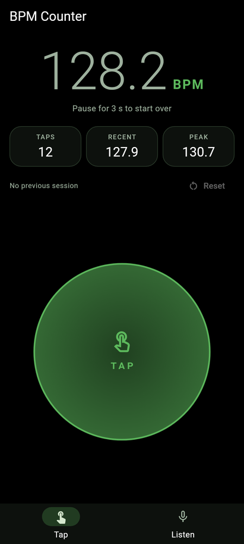
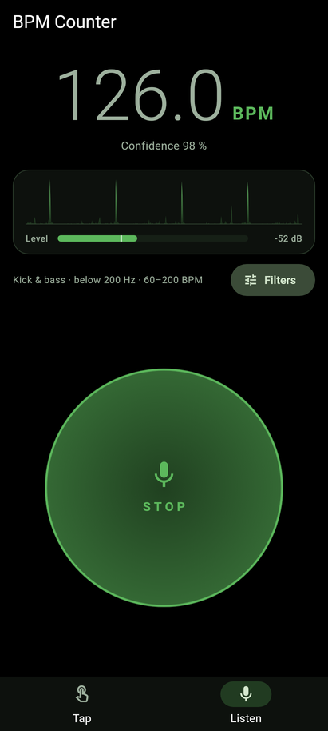
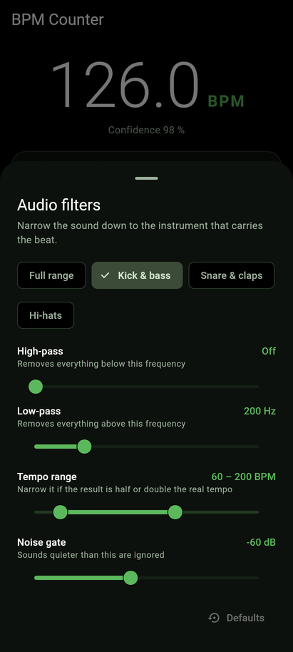

# BPM Counter

A black-and-green tempo counter for Android. Tap along with the beat, or let the
microphone detect the tempo for you.

| Tap mode | Listen mode | Audio filters |
| :---: | :---: | :---: |
|  |  |  |

- **Tap mode**: tap the big circle (or press <kbd>Space</kbd> / <kbd>Enter</kbd> on a
  keyboard) along with the music. You get the average tempo since your first tap, the
  tempo of your last few taps, the session peak and the previous session.
- **Listen mode**: the app listens through the microphone and detects the tempo. High-pass
  and low-pass filters let you focus on the instrument that carries the beat.
- **Private**: the app has **no internet permission**. The only permission it asks for is
  the microphone, and only when you start the listen mode. Audio is analysed in memory and
  never stored or sent anywhere.
- Built for **Android 17** (API 37), runs on Android 8.0 and newer, including phones in
  landscape, foldables and tablets.

## Install

1. Open the [latest release](https://github.com/KaiFra/BPM-Counter/releases/latest) on your
   phone and download `bpm-counter-<version>.apk`.
2. Open the downloaded file. If Android asks, allow your browser or file manager to
   *install unknown apps*.
3. Confirm the installation.

To check a download, compare its SHA-256 with `SHA256SUMS.txt` from the same release.

## Use it

### Tap mode

- Tap the circle on every beat. The big number is the average since your first tap and gets
  more precise the longer you tap. **Recent** shows the last five taps, so it reacts quickly
  to tempo changes. **Peak** is the highest average of this session.
- Taps register when your finger touches the screen, not when it is lifted, for the most
  precise timing.
- Pause for more than 3 seconds and the next tap starts a new session. **Reset** (or
  <kbd>Esc</kbd>) does the same immediately. The finished session is shown as "Previous".

### Listen mode

1. Switch to **Listen** and tap the circle. The first time, Android asks for microphone
   access.
2. Hold the phone near the speaker. After about 3 seconds the tempo appears; it updates twice
   a second and settles over the next few seconds.
3. The circle flashes on every detected beat, and the graph shows the hits the app hears.
   Tap the circle again to stop. The microphone is also released as soon as you leave the
   mode or the app.

**Getting a better result** – open **Filters**:

| Setting | What it does | Tip |
| --- | --- | --- |
| Presets | Quick filter choices | *Kick & bass* (default) works for most pop and dance music. *Hi-hats* for music without strong bass, *Full range* for acoustic music. |
| High-pass | Removes everything **below** the frequency | Raise it to ignore rumble or bass lines. |
| Low-pass | Removes everything **above** the frequency | Lower it to ignore vocals, cymbals and talking. |
| Tempo range | Tempos the detector may report | If you get half or double the real tempo, narrow the range (e.g. 120–240 for drum & bass). |
| Noise gate | Sounds quieter than this are ignored | Raise it in noisy rooms. The white mark on the level meter shows the gate; the bar turns green above it. |

Your filter settings are remembered.

### How the detection works

The microphone signal (44.1 kHz, no automatic gain or noise suppression) runs through the
selected filters (4th-order Butterworth high/low pass). Every 5 ms the loudness is measured;
sudden rises in loudness, like a drum hit, form an "onset envelope". The autocorrelation of
the last 8 seconds of that envelope shows which beat period repeats best. The display shows
the median of the last five confident estimates, so single outliers don't make the number
jump. Everything runs on the phone in plain Dart (`lib/src/audio/`).

## Build it yourself

Requirements:

- [Flutter](https://docs.flutter.dev/get-started/install) 3.47 or newer (stable channel)
- Android SDK with platform 37 (Android 17), e.g. via Android Studio
- JDK 17 or newer

```sh
git clone https://github.com/KaiFra/BPM-Counter.git
cd BPM-Counter
flutter pub get

flutter test                  # run all tests
flutter run                   # run on a connected device or emulator
flutter build apk --release   # build/app/outputs/flutter-apk/app-release.apk
```

Install a built APK on a connected device with `flutter install` or
`adb install build/app/outputs/flutter-apk/app-release.apk`.

Without a signing key, release builds are signed with your local debug key. To sign with your
own key, create one and point `android/key.properties` (ignored by git) at it:

```sh
keytool -genkey -v -keystore ~/bpm-counter.jks -keyalg RSA -keysize 4096 \
  -validity 10000 -alias bpm-counter
```

```properties
# android/key.properties
storeFile=/home/you/bpm-counter.jks
storePassword=...
keyAlias=bpm-counter
keyPassword=...
```

> Debug builds (`flutter run`) include the internet permission, because the Flutter tools
> need it for hot reload and debugging. Release builds never do.

## Project layout

```
lib/
  main.dart
  src/
    app.dart                  app setup
    tap/tap_tracker.dart      tap tempo logic
    audio/
      biquad.dart             high/low pass filters
      tempo_detector.dart     onset envelope + autocorrelation tempo estimation
      detector_settings.dart  filter settings and presets
      listen_controller.dart  microphone -> detector -> UI
      audio_input.dart        microphone access (record plugin, 16-bit PCM)
      settings_store.dart     remembers the filter settings
    ui/                       screens, theme and widgets
test/                         unit and widget tests (synthetic drum loops, fake microphone)
tool/check_apk_permissions.sh fails if an APK asks for more than the microphone
```

## Releases

Releases are built by GitHub Actions (`.github/workflows/release.yml`). To publish one:

```sh
git tag v2.0.0
git push origin v2.0.0
```

The workflow runs the tests, builds the APK with version name `2.0.0` and version code
`20000` (`major * 10000 + minor * 100 + patch`), verifies its permissions and creates a GitHub
release with the APK and its checksum.

Signing: add these repository secrets (*Settings → Secrets and variables → Actions*) so that
releases are signed with your key and can be updated in place:

| Secret | Value |
| --- | --- |
| `ANDROID_KEYSTORE_BASE64` | `base64 -w0 bpm-counter.jks` |
| `ANDROID_KEYSTORE_PASSWORD` | keystore password |
| `ANDROID_KEY_ALIAS` | key alias, e.g. `bpm-counter` |
| `ANDROID_KEY_PASSWORD` | key password (defaults to the keystore password) |

Without these secrets, the release is signed with a temporary debug key and marked as
pre-release. Keep the keystore safe: Android only accepts updates signed with the same key.

Every push and pull request runs formatting, analysis, tests, a release build and the
permission check (`.github/workflows/ci.yml`).
